<div align="center">


# Sugarat SDGOODS development kit

English | [中文](README.zh.md)

<a href="boards/sdgoods-esp32s3-round.json"></a> <a href="references/environment.md"></a> <a href="references/components.md"></a> <a href="SKILL.md"></a> <a href="LICENSE"></a>

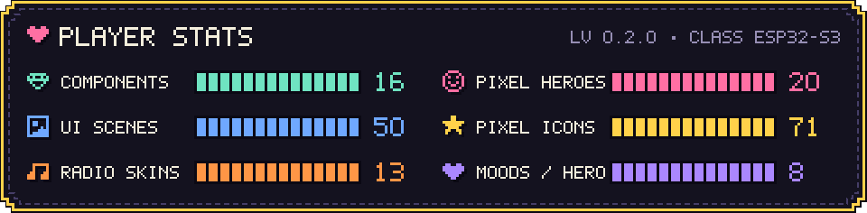

</div>

## Summary

Give your preferred Agent this kit's GitHub entry link to develop firmware for the SDGOODS ESP32-S3 360×360 round badge. The kit includes a source foundation, Watch/Game themes, 16 component bundles, 20 pixel characters, a complete radio application and hardware records. It works without Sugarat or this parent repository. ESP-IDF and its toolchain are installed separately.

<table align="center">
<tr>
<td align="center" width="25%">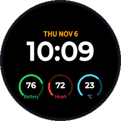<br><b>Watch theme</b><br><sub>22 gallery screens</sub></td>
<td align="center" width="25%">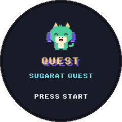<br><b>Game theme</b><br><sub>28 gallery screens</sub></td>
<td align="center" width="25%">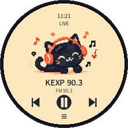<br><b>Sugarat Radio</b><br><sub>complete source play</sub></td>
<td align="center" width="25%">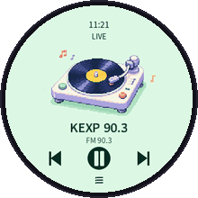<br><b>13 radio skins</b><br><sub>swipe to switch</sub></td>
</tr>
</table>

## Contents

- [Give this kit to an Agent](#give-this-kit-to-an-agent)
- [Use the sources locally](#use-the-sources-locally)
- [Architecture](#architecture)
- [Components](#components)
- [Pixel characters](#pixel-characters)
- [UI themes](#ui-themes)
- [Source plays](#source-plays)
- [Resources and verification](#resources-and-verification)
- [Publishing](#publishing)


<a id="give-this-kit-to-an-agent"></a>
## Give this kit to an Agent

Copy [COPY_TO_AGENT.txt](COPY_TO_AGENT.txt) into your preferred Agent, then describe the application you want. The sentence points to the fixed [v0.2.0 Agent entry](https://github.com/suoyousheng-bot/sugarat-sdgoods/blob/v0.2.0/AGENTS.md); the complete [v0.2.0 source ZIP](https://github.com/suoyousheng-bot/sugarat-sdgoods/archive/refs/tags/v0.2.0.zip) contains the matching kit. The receiving Agent reads [AGENTS.md](AGENTS.md) and [SKILL.md](SKILL.md), then downloads that version. A supported Skill installer must retain the whole directory, including assets and scripts.

Generate the sentence for an actual publication destination with `python3 scripts/kit.py prompt --repo <repository-url> --ref <release-tag-or-commit> --task <application-request>`. This command formats text; it does not publish or check repository access. The output can be copied by a product clipboard action.

<a id="use-the-sources-locally"></a>
## Use the sources locally

Use Python 3.9 or newer for the kit helper. Run from the kit root:

```sh
python3 scripts/kit.py check
python3 scripts/kit.py components --id sdgoods-ui-watch
python3 scripts/kit.py init --directory ../my-badge --name my_badge --components sdgoods-ui-watch
```

Initialization creates a new firmware project and installs the theme with its Pixel dependency. It leaves application wiring to the Agent and refuses an existing destination. For an existing compatible project, use `python3 scripts/kit.py add --directory ../my-badge --components sdgoods-case-time`; differing files are preserved and reported before component writes begin.

Read [development](references/development.md) and [environment](references/environment.md) before compiling. The helper never installs SDKs, opens a port, flashes, or creates a private backup. Device work follows [deployment](references/deployment.md) and the user's authorization.


<a id="architecture"></a>
## Architecture

A request passes through four parts of the kit. Entry documents tell the Agent what to read and what needs authorization. The helper verifies files and copies sources. Source resources hold the firmware foundation, components, board records and plays. The user's own project is where the Agent wires the application, builds it with ESP-IDF and, only after approval, writes it to the device.


```text
sugarat-sdgoods/
├── COPY_TO_AGENT.txt      one-sentence Agent handoff
├── AGENTS.md, SKILL.md    Agent entry rules and workflow
├── references/            hardware, environment, development, deployment, components, publishing
├── scripts/kit.py         check, components, init, add, plays, play-prompt, prompt
├── assets/
│   ├── templates/         ESP-IDF firmware foundation archive and its manifest
│   ├── starters/          Watch and Game application entry files
│   └── components/        16 source component bundles
├── boards/                board record, pins, partitions, sdkconfig defaults
├── plays/                 complete source plays, indexed by plays.json
├── media/readme/          README images
├── resources.lock.json    versions, dependencies, upstream verification limits
└── checksums.sha256       SHA-256 inventory of distributed files
```


<a id="components"></a>
## Components

`init` and `add` install any of these 16 bundles and add their dependencies automatically. Choose one UI theme per application. Each card links to the component README with its interface, ownership rules and recorded verification scope; [components](references/components.md) lists dependencies and integration constraints. Theme, case and Wi-Fi cards show the closest host LVGL 8.3.11 gallery or play screen at 360×360; driver cards use icons from the Game theme's pixel icon set.

<table>
<tr>
<td align="center" width="25%"><a href="assets/components/sdgoods-ui-watch/components/sugarat_watch/README.md"></a><br><b><code>sdgoods-ui-watch</code></b><br><sub>Watch-style UI, Chinese fonts and icons</sub></td>
<td align="center" width="25%"><a href="assets/components/sdgoods-ui-game/components/sugarat_game/README.md">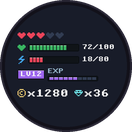</a><br><b><code>sdgoods-ui-game</code></b><br><sub>Game pixel UI and RPG controls</sub></td>
<td align="center" width="25%"><a href="assets/components/sdgoods-pixel-characters/components/sugarat_pixel/README.md"></a><br><b><code>sdgoods-pixel-characters</code></b><br><sub>20 animated pixel characters</sub></td>
<td align="center" width="25%"><a href="assets/components/sdgoods-wifi-ui/components/sugarat_wifi_ui/README.md"></a><br><b><code>sdgoods-wifi-ui</code></b><br><sub>Round-screen bilingual Wi-Fi setup</sub></td>
</tr>
<tr>
<td align="center"><a href="assets/components/sdgoods-case-time/components/sugarat_time/README.md">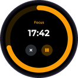</a><br><b><code>sdgoods-case-time</code></b><br><sub>Focus, countdown, stopwatch and clock</sub></td>
<td align="center"><a href="assets/components/sdgoods-case-media/components/sugarat_media/README.md">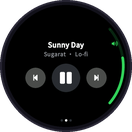</a><br><b><code>sdgoods-case-media</code></b><br><sub>Local player, cover and controls</sub></td>
<td align="center"><a href="assets/components/sdgoods-case-companion/components/sugarat_companion/README.md"></a><br><b><code>sdgoods-case-companion</code></b><br><sub>Pet, mood and voice-state pages</sub></td>
<td align="center"><a href="assets/components/sdgoods-case-data/components/sugarat_data/README.md"></a><br><b><code>sdgoods-case-data</code></b><br><sub>Gauges, history and alerts; data source not included</sub></td>
</tr>
<tr>
<td align="center"><a href="assets/components/sdgoods-case-control/components/sugarat_control/README.md">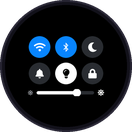</a><br><b><code>sdgoods-case-control</code></b><br><sub>Switch, slider and remote-control simulation</sub></td>
<td align="center"><a href="assets/components/wifi-provisioning/components/sugarat_wifi/README.md"></a><br><b><code>wifi-provisioning</code></b><br><sub>Wi-Fi scan, connect, save and hotspot setup</sub></td>
<td align="center"><a href="assets/components/sdgoods-audio/components/sugarat_audio/README.md"></a><br><b><code>sdgoods-audio</code></b><br><sub>Microphone, speaker, PCM and voice streams</sub></td>
<td align="center"><a href="assets/components/sdgoods-imu/components/sugarat_imu/README.md"></a><br><b><code>sdgoods-imu</code></b><br><sub>QMI8658 motion sensor</sub></td>
</tr>
<tr>
<td align="center"><a href="assets/components/sdgoods-battery/components/sugarat_battery/README.md"></a><br><b><code>sdgoods-battery</code></b><br><sub>Battery voltage and estimated level</sub></td>
<td align="center"><a href="assets/components/sdgoods-frame-stream/components/sugarat_frame/README.md"></a><br><b><code>sdgoods-frame-stream</code></b><br><sub>Animation frame scheduling and direct panel writes</sub></td>
<td align="center"><a href="assets/components/https-client/components/sugarat_https/README.md"></a><br><b><code>https-client</code></b><br><sub>Bounded HTTPS requests with backoff</sub></td>
<td align="center"><a href="assets/components/deotaland-agent-link/components/sugarat_agent_link/README.md"></a><br><b><code>deotaland-agent-link</code></b><br><sub>Deotaland activation and realtime voice; needs product configuration</sub></td>
</tr>
</table>


<a id="pixel-characters"></a>
## Pixel characters

`sdgoods-pixel-characters` draws 20 characters in three families: 5 people, 8 animals and 7 fantasy characters. Each is a 32×32 4-bit sprite with 8 moods and a blink frame, scaled 1–10× with crisp edges by `sp_avatar()`. The Watch and Game themes install it as a dependency for mascots, companions, heroes and dialog portraits.

<p align="center">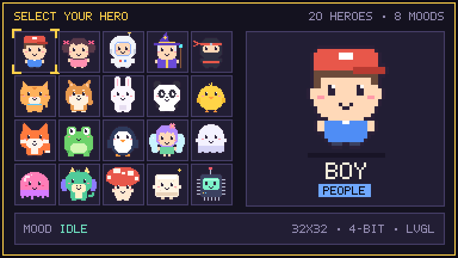</p>

<p align="center">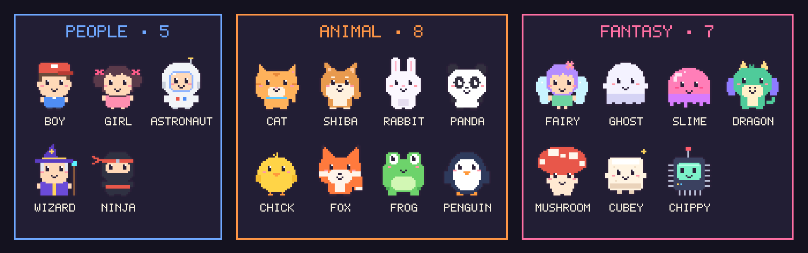</p>

<details>
<summary><b>All 8 moods and the blink frame for every character</b></summary>
<br>
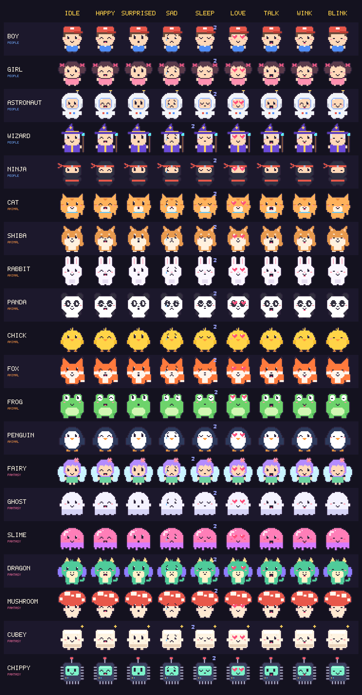
</details>


<a id="ui-themes"></a>
## UI themes

The Watch and Game themes share function names, enums, icon names and argument order, so a screen switches style by renaming its `sw_` or `sg_` prefix. Watch has a watchOS look with anti-aliased text; Game uses beveled pixel boxes, 1-bit pixel Chinese text and RPG components such as dialogs, inventory and achievements. Each theme ships a gallery example built only from its public API; copy the closest screen as an application starting point. The images use English sample text; the shipped gallery examples use Chinese strings.

<table>
<tr>
<td align="center" width="50%"><br><b>Watch</b> · <code>sugarat_watch</code> · 22 screens</td>
<td align="center" width="50%"><br><b>Game</b> · <code>sugarat_game</code> · 28 screens</td>
</tr>
</table>

<details>
<summary><b>Full Watch and Game galleries, labeled by component function</b></summary>
<br>
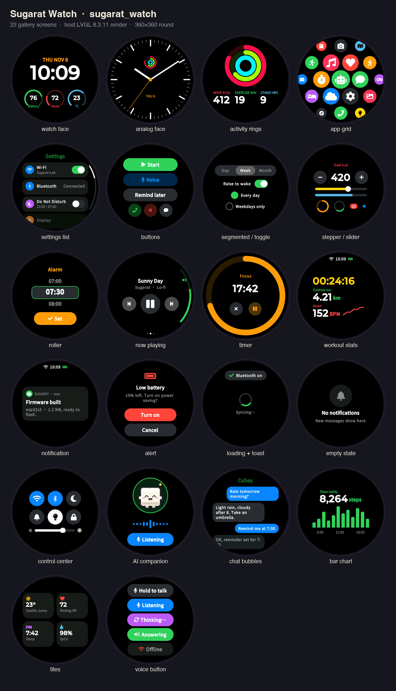
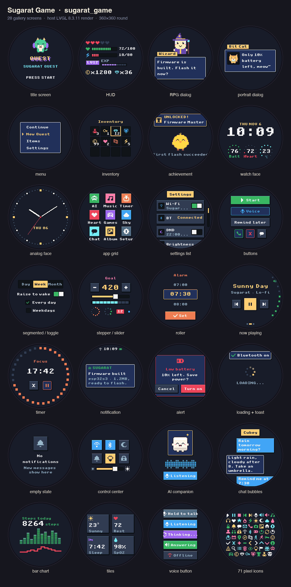
</details>


<a id="source-plays"></a>
## Source plays

A source play is a complete application you can copy and modify. Sugarat Radio is an Internet radio: Wi-Fi setup on first start, US station directory, 16 regional markets, sleep timer, and 13 skins switched by swiping left or right. The images below are host renders of its skins and pages.

<table>
<tr>
<td align="center"><br><sub>cat-dj</sub></td>
<td align="center">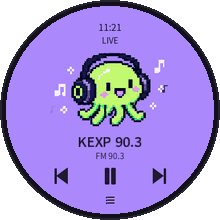<br><sub>pixel-host</sub></td>
<td align="center"><br><sub>vinyl-pixel</sub></td>
<td align="center">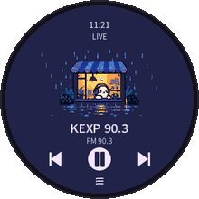<br><sub>rainy-shop</sub></td>
</tr>
<tr>
<td align="center">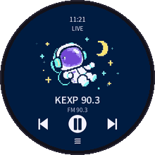<br><sub>space-signal</sub></td>
<td align="center">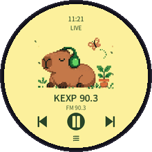<br><sub>garden-capybara</sub></td>
<td align="center">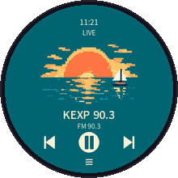<br><sub>seaside-sunset</sub></td>
<td align="center">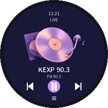<br><sub>vinyl-night</sub></td>
</tr>
</table>

<p align="center">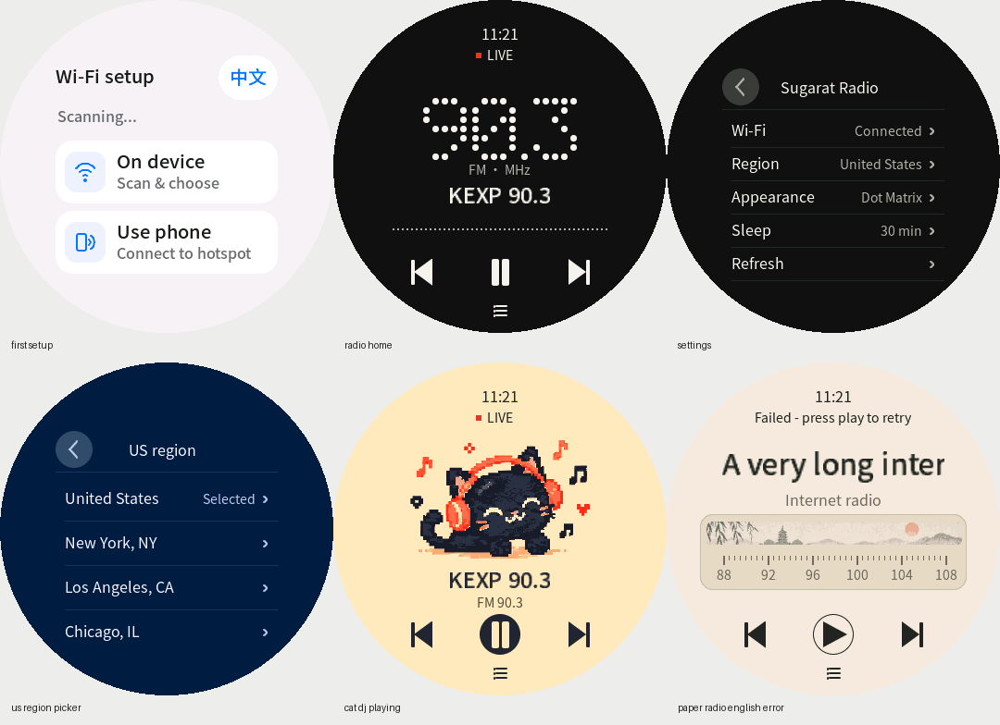</p>

| Result | Sugarat Radio 0.1.0 |
| --- | --- |
| Desktop preview | Passed |
| Firmware build (ESP-IDF 5.5.4) | Passed |
| Written bytes verified on a device | Passed |
| Startup observed | Passed |
| Full device acceptance | Not yet recorded |

Run `python3 scripts/kit.py plays --id sugarat-radio` to locate the complete radio application. [plays.json](plays.json) binds its stable ID, version and hardware to the source directory. After verification, read the play guide, build README and validation report there, then copy the complete directory into a new project before modifying it. Generate a fixed-version handoff with `python3 scripts/kit.py play-prompt --id sugarat-radio --repo https://github.com/suoyousheng-bot/sugarat-sdgoods --ref v0.2.0 --task "Customize the radio"`. The kit contains source, not a firmware download; inspect actual partitions before any device write.


<a id="resources-and-verification"></a>
## Resources and verification

[resources.lock.json](resources.lock.json) records versions, dependencies, integration notes and upstream verification limits. [checksums.sha256](checksums.sha256) covers distributed files. The original template archive and its per-source manifest remain intact. [Hardware records](references/hardware.md) describe documented specifications; [components](references/components.md) routes to included sources and examples. [NOTICE.md](NOTICE.md) identifies license owners.

Compilation, written-byte verification, startup and physical acceptance are separate results. Historical acceptance belongs to the recorded application and device; every new integration needs its own checks. This kit includes no prebuilt firmware, device backups, credentials, full SDK, or Sugarat native-preview runtime. Local validation results and remaining platform checks are recorded in [VALIDATION.md](VALIDATION.md).


<a id="publishing"></a>
## Publishing

The public repository is [suoyousheng-bot/sugarat-sdgoods](https://github.com/suoyousheng-bot/sugarat-sdgoods), with source plays in `v0.2.0` and the original `v0.1.0` retained. To publish a fork, copy this entire directory as its repository root and follow [publishing](references/publishing.md) to verify files and regenerate the handoff sentence for your destination.

## Dev Note

None.
