<div align="center">


# Sugarat SDGOODS 开发资源包

[English](README.md) | 中文

<a href="boards/sdgoods-esp32s3-round.json"></a> <a href="references/environment.md"></a> <a href="references/components.md"></a> <a href="SKILL.md"></a> <a href="LICENSE"></a>

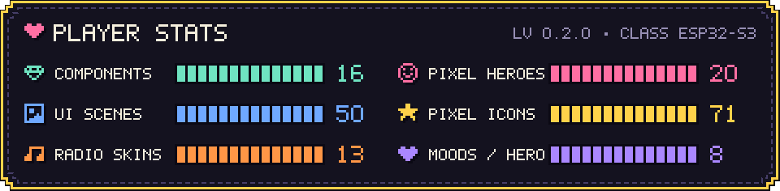

</div>

## 摘要

把本资源包的 GitHub 入口链接交给常用 Agent，即可按说明为 SDGOODS ESP32-S3 360×360 圆形徽章开发固件。资源包包含基础源码模板、Watch/Game 主题、16 个组件包、20 个像素角色、一个完整电台应用和硬件资料。使用时不依赖 Sugarat 或本资源包所在的上级仓库。ESP-IDF 和工具链需单独安装。

<table align="center">
<tr>
<td align="center" width="25%">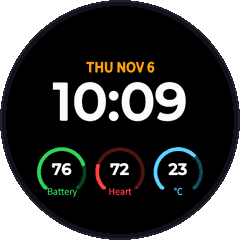<br><b>Watch 主题</b><br><sub>22 个示例画面</sub></td>
<td align="center" width="25%">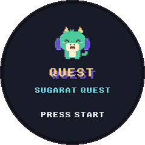<br><b>Game 主题</b><br><sub>28 个示例画面</sub></td>
<td align="center" width="25%">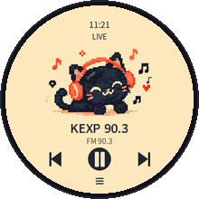<br><b>Sugarat Radio</b><br><sub>完整玩法源码</sub></td>
<td align="center" width="25%"><br><b>13 套电台皮肤</b><br><sub>左右滑动切换</sub></td>
</tr>
</table>

## 目录

- [交给其他 Agent](#give-this-kit-to-an-agent)
- [本地使用源码](#use-the-sources-locally)
- [架构](#architecture)
- [组件](#components)
- [像素角色](#pixel-characters)
- [UI 主题](#ui-themes)
- [玩法源码](#source-plays)
- [资源和验证](#resources-and-verification)
- [发布](#publishing)


<a id="give-this-kit-to-an-agent"></a>
## 交给其他 Agent

复制 [COPY_TO_AGENT.txt](COPY_TO_AGENT.txt) 给常用 Agent，再描述想做的应用。文案指向固定的 [v0.2.0 Agent 入口](https://github.com/suoyousheng-bot/sugarat-sdgoods/blob/v0.2.0/AGENTS.md)；同版本完整资源包可从 [v0.2.0 源码 ZIP](https://github.com/suoyousheng-bot/sugarat-sdgoods/archive/refs/tags/v0.2.0.zip) 获取。接收方 Agent 先读 [AGENTS.md](AGENTS.md) 和 [SKILL.md](SKILL.md)，再下载该版本资源。支持 Skill 安装的工具必须保留整个目录，包括资源和脚本。

可用 `python3 scripts/kit.py prompt --repo <repository-url> --ref <release-tag-or-commit> --task <application-request>` 为实际发布地址生成一句话。此命令只生成文字，不发布仓库，也不检查访问权限；产品的复制按钮可以直接复制其输出。

<a id="use-the-sources-locally"></a>
## 本地使用源码

资源包辅助脚本需要 Python 3.9 或更新版本。以下命令在资源包根目录运行：

```sh
python3 scripts/kit.py check
python3 scripts/kit.py components --id sdgoods-ui-watch
python3 scripts/kit.py init --directory ../my-badge --name my_badge --components sdgoods-ui-watch
```

初始化会创建一个新的固件工程，并安装主题及其 Pixel 依赖。应用入口由 Agent 显式接入；目标目录已存在时拒绝初始化。已有兼容工程可用 `python3 scripts/kit.py add --directory ../my-badge --components sdgoods-case-time` 安装组件；脚本在写入组件前报告不同内容的文件并保留它们。

编译前阅读 [开发说明](references/development.md) 和 [环境说明](references/environment.md)。辅助脚本不会安装 SDK、打开串口、烧录或创建私有备份。设备操作遵循 [部署说明](references/deployment.md) 和用户授权。


<a id="architecture"></a>
## 架构

一次开发请求依次经过资源包的四个部分。入口文档告诉 Agent 先读什么、哪些操作需要授权。辅助脚本校验文件并复制源码。源码资源包含固件底座、组件、板卡资料和玩法。用户自己的工程由 Agent 接入应用、用 ESP-IDF 编译，并只在用户批准后写入设备。


```text
sugarat-sdgoods/
├── COPY_TO_AGENT.txt      one-sentence Agent handoff
├── AGENTS.md, SKILL.md    Agent entry rules and workflow
├── references/            hardware, environment, development, deployment, components, publishing
├── scripts/kit.py         check, components, init, add, plays, play-prompt, prompt
├── assets/
│   ├── templates/         ESP-IDF firmware foundation archive and its manifest
│   ├── starters/          Watch and Game application entry files
│   └── components/        16 source component bundles
├── boards/                board record, pins, partitions, sdkconfig defaults
├── plays/                 complete source plays, indexed by plays.json
├── media/readme/          README images
├── resources.lock.json    versions, dependencies, upstream verification limits
└── checksums.sha256       SHA-256 inventory of distributed files
```


<a id="components"></a>
## 组件

`init` 和 `add` 可安装以下 16 个组件包，并自动加入依赖。每个应用选择一种 UI 主题。每张卡片链接到组件 README，其中包含接口、所有权规则和已记录的验证范围；[组件目录](references/components.md) 列出依赖和集成约束。主题、案例和 Wi-Fi 卡片显示最接近的主机端 LVGL 8.3.11 示例或玩法画面（360×360）；驱动卡片使用 Game 主题像素图标集中的图标。

<table>
<tr>
<td align="center" width="25%"><a href="assets/components/sdgoods-ui-watch/components/sugarat_watch/README.zh.md"></a><br><b><code>sdgoods-ui-watch</code></b><br><sub>Watch 风格 UI、中文字体和图标</sub></td>
<td align="center" width="25%"><a href="assets/components/sdgoods-ui-game/components/sugarat_game/README.zh.md">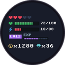</a><br><b><code>sdgoods-ui-game</code></b><br><sub>Game 像素风格 UI 和 RPG 控件</sub></td>
<td align="center" width="25%"><a href="assets/components/sdgoods-pixel-characters/components/sugarat_pixel/README.zh.md"></a><br><b><code>sdgoods-pixel-characters</code></b><br><sub>20 个动画像素角色</sub></td>
<td align="center" width="25%"><a href="assets/components/sdgoods-wifi-ui/components/sugarat_wifi_ui/README.zh.md">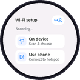</a><br><b><code>sdgoods-wifi-ui</code></b><br><sub>圆屏中英文 Wi-Fi 配网页面</sub></td>
</tr>
<tr>
<td align="center"><a href="assets/components/sdgoods-case-time/components/sugarat_time/README.zh.md"></a><br><b><code>sdgoods-case-time</code></b><br><sub>专注、倒计时、秒表和时钟</sub></td>
<td align="center"><a href="assets/components/sdgoods-case-media/components/sugarat_media/README.zh.md">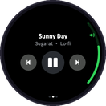</a><br><b><code>sdgoods-case-media</code></b><br><sub>本地播放器、封面和控制</sub></td>
<td align="center"><a href="assets/components/sdgoods-case-companion/components/sugarat_companion/README.zh.md"></a><br><b><code>sdgoods-case-companion</code></b><br><sub>宠物、心情和语音状态页面</sub></td>
<td align="center"><a href="assets/components/sdgoods-case-data/components/sugarat_data/README.zh.md"></a><br><b><code>sdgoods-case-data</code></b><br><sub>仪表、历史和告警；数据源自备</sub></td>
</tr>
<tr>
<td align="center"><a href="assets/components/sdgoods-case-control/components/sugarat_control/README.zh.md">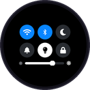</a><br><b><code>sdgoods-case-control</code></b><br><sub>开关、滑块和遥控本地模拟</sub></td>
<td align="center"><a href="assets/components/wifi-provisioning/components/sugarat_wifi/README.zh.md"></a><br><b><code>wifi-provisioning</code></b><br><sub>Wi-Fi 扫描、连接、保存和热点配网</sub></td>
<td align="center"><a href="assets/components/sdgoods-audio/components/sugarat_audio/README.zh.md"></a><br><b><code>sdgoods-audio</code></b><br><sub>麦克风、扬声器、PCM 和语音流</sub></td>
<td align="center"><a href="assets/components/sdgoods-imu/components/sugarat_imu/README.zh.md"></a><br><b><code>sdgoods-imu</code></b><br><sub>QMI8658 运动传感器</sub></td>
</tr>
<tr>
<td align="center"><a href="assets/components/sdgoods-battery/components/sugarat_battery/README.zh.md"></a><br><b><code>sdgoods-battery</code></b><br><sub>电池电压和估算电量</sub></td>
<td align="center"><a href="assets/components/sdgoods-frame-stream/components/sugarat_frame/README.zh.md"></a><br><b><code>sdgoods-frame-stream</code></b><br><sub>连续动画帧调度和面板直传</sub></td>
<td align="center"><a href="assets/components/https-client/components/sugarat_https/README.zh.md"></a><br><b><code>https-client</code></b><br><sub>受限 HTTPS 请求与退避</sub></td>
<td align="center"><a href="assets/components/deotaland-agent-link/components/sugarat_agent_link/README.zh.md"></a><br><b><code>deotaland-agent-link</code></b><br><sub>Deotaland 激活和实时语音；需用户产品配置</sub></td>
</tr>
</table>


<a id="pixel-characters"></a>
## 像素角色

`sdgoods-pixel-characters` 提供三大类 20 个角色：人物 5 个、动物 8 个、精灵 7 个。每个角色是 32×32 的 4 位像素图，有 8 种表情和一帧眨眼，由 `sp_avatar()` 按 1–10 倍放大并保持像素边缘清晰。Watch 和 Game 主题会把它作为依赖安装，用于吉祥物、陪伴角色、游戏主角和对话头像。

<p align="center">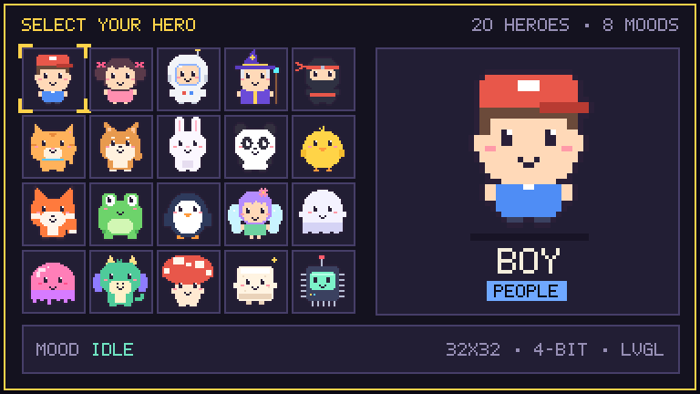</p>

<p align="center">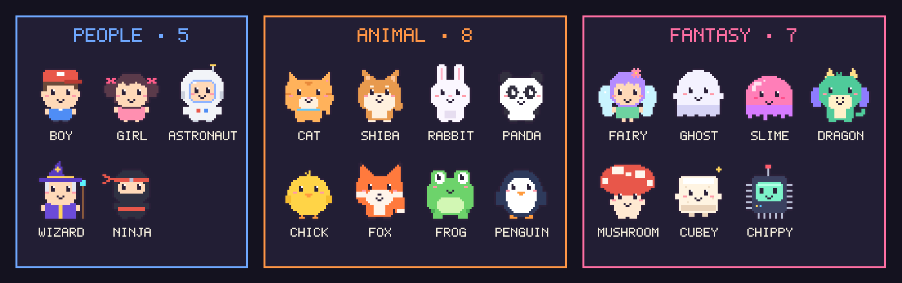</p>

<details>
<summary><b>每个角色的 8 种表情和眨眼帧</b></summary>
<br>
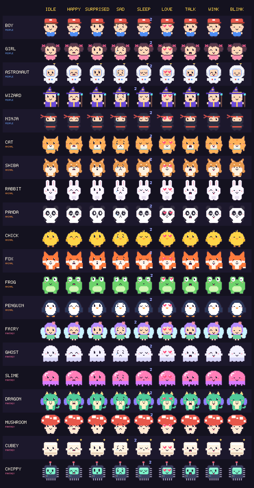
</details>


<a id="ui-themes"></a>
## UI 主题

Watch 和 Game 主题的函数名、枚举、图标名和参数顺序相同，把 `sw_` 或 `sg_` 前缀互换即可切换画面风格。Watch 是 watchOS 风格，文字抗锯齿；Game 使用斜面像素框、1 位像素中文字体，以及对话框、背包、成就等 RPG 控件。每个主题都附带只用公开 API 构建的示例画廊，可复制最接近的画面作为应用起点。图片使用英文示例文字；随包的画廊示例使用中文字符串。

<table>
<tr>
<td align="center" width="50%"><br><b>Watch</b> · <code>sugarat_watch</code> · 22 个画面</td>
<td align="center" width="50%"><br><b>Game</b> · <code>sugarat_game</code> · 28 个画面</td>
</tr>
</table>

<details>
<summary><b>完整 Watch 和 Game 画廊（标注组件函数名）</b></summary>
<br>
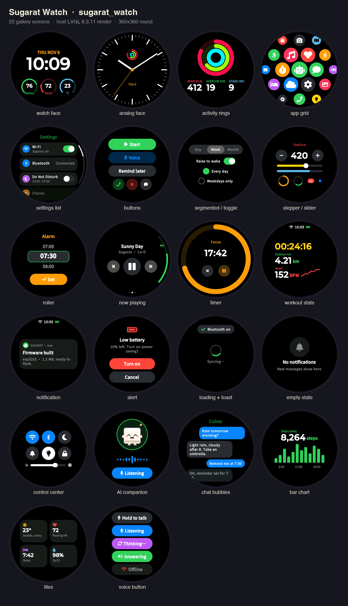
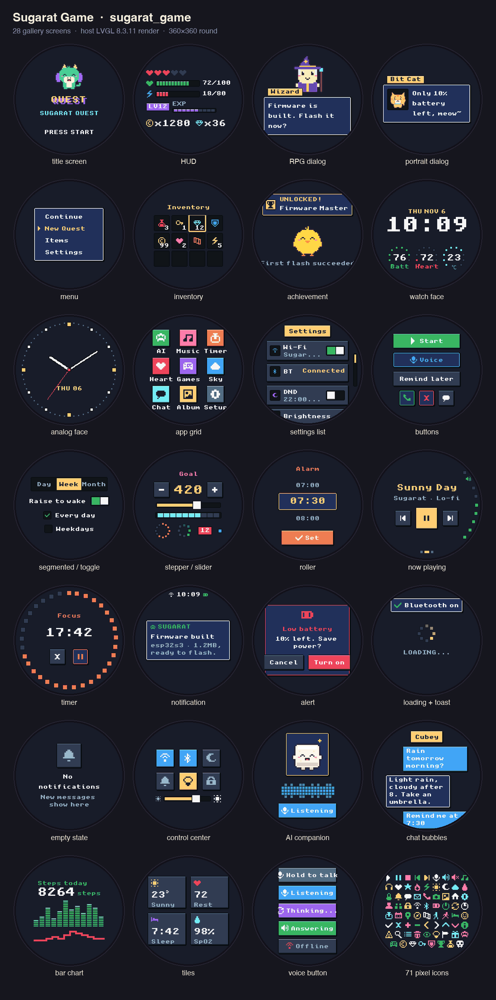
</details>


<a id="source-plays"></a>
## 玩法源码

玩法源码是可直接复制、修改的完整应用。Sugarat Radio 是一款网络电台：首次启动进入 Wi-Fi 配网，提供美国电台目录、16 个城市/州区域、睡眠定时，以及左右滑动切换的 13 套皮肤。下方图片为其皮肤和页面的主机端渲染。

<table>
<tr>
<td align="center"><br><sub>cat-dj</sub></td>
<td align="center">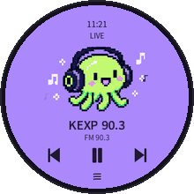<br><sub>pixel-host</sub></td>
<td align="center"><br><sub>vinyl-pixel</sub></td>
<td align="center">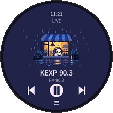<br><sub>rainy-shop</sub></td>
</tr>
<tr>
<td align="center">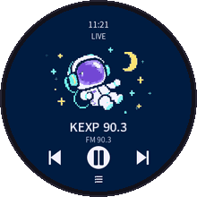<br><sub>space-signal</sub></td>
<td align="center">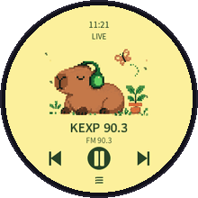<br><sub>garden-capybara</sub></td>
<td align="center">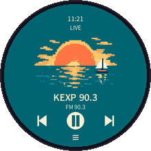<br><sub>seaside-sunset</sub></td>
<td align="center"><br><sub>vinyl-night</sub></td>
</tr>
</table>

<p align="center">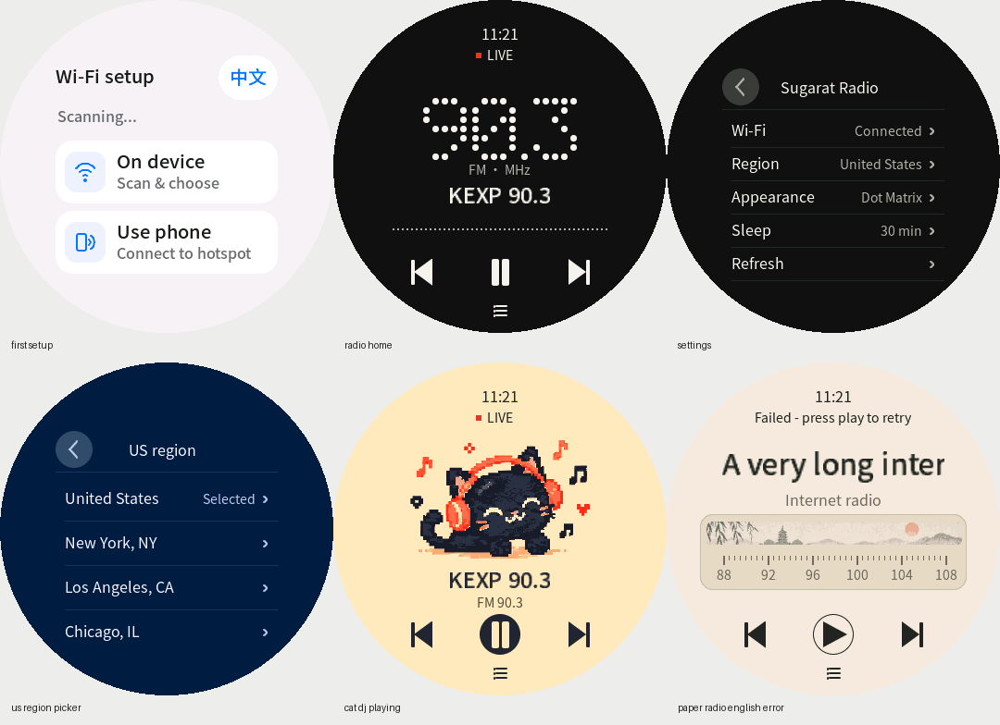</p>

| 结果 | Sugarat Radio 0.1.0 |
| --- | --- |
| 桌面预览 | 通过 |
| 固件编译（ESP-IDF 5.5.4） | 通过 |
| 设备写入字节验证 | 通过 |
| 启动观察 | 通过 |
| 完整真机验收 | 尚未记录 |

运行 `python3 scripts/kit.py plays --id sugarat-radio` 定位完整电台应用。[plays.json](plays.json) 将稳定 ID、版本和硬件绑定到源码目录。校验通过后，阅读目录中的玩法指南、构建 README 和验证报告，将完整目录复制到新工程后再修改。用 `python3 scripts/kit.py play-prompt --id sugarat-radio --repo https://github.com/suoyousheng-bot/sugarat-sdgoods --ref v0.2.0 --task "Customize the radio"` 生成固定版本交接文案。资源包包含源码，不是固件下载；写入设备前需检查实际分区。


<a id="resources-and-verification"></a>
## 资源和验证

[resources.lock.json](resources.lock.json) 记录版本、依赖、集成方法和上游验证范围。[checksums.sha256](checksums.sha256) 覆盖分发文件。原始模板压缩包及逐文件清单完整保留。[硬件资料](references/hardware.md) 说明文档参数；[组件目录](references/components.md) 指向包内源码和示例。[NOTICE.md](NOTICE.md) 说明许可归属。

编译、写入字节验证、启动和真机验收分别记录。历史验收只属于记录中的应用和设备，每次新集成都需要验证。本包不包含预编译固件、设备备份、凭据、完整 SDK 或 Sugarat 原生预览运行时。本地验证结果和其余平台检查范围见 [VALIDATION.md](VALIDATION.md)。


<a id="publishing"></a>
## 发布

公开仓库为 [suoyousheng-bot/sugarat-sdgoods](https://github.com/suoyousheng-bot/sugarat-sdgoods)，`v0.2.0` 包含完整玩法源码，保留首个资源快照 `v0.1.0`。发布到其他仓库时，将整个目录复制为仓库根目录，按 [发布说明](references/publishing.md) 检查文件并重新生成对应地址的交接文案。

## 开发备注

无。
